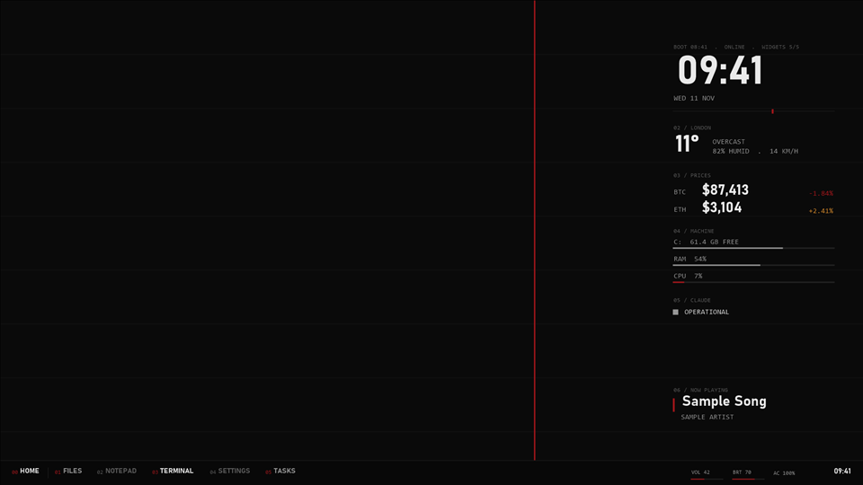

# deskforge



## Give this to your Claude

Copy this into your coding agent (Claude Code or similar) after cloning or downloading this repo:

```text
I've given you the deskforge repo. Read its AGENTS.md and help me build my desk.
Ask before changing anything on my machine. Show me the dry run first.
```

The agent asks a few questions, writes `config\desk.json`, shows you the dry run, and changes nothing until
you say yes. Undo is one command.

## What it is

A free, MIT-licensed kit for a customised Windows 10 desktop, built on Rainmeter:

- **Panel**: clock, weather, two coin prices, disk, memory and CPU, Claude status.
- **Now**: the Spotify track playing.
- **Dock**: a text dock with your apps, volume, brightness and the clock.
- **Home**: a full-screen launcher on Win+Z.
- **Boot**: a 3 second reveal after sign-in, unlock or wake.
- **Four themes**: red on black, paper light, terminal green, minimal grey.
- **Addons**, off by default: Tape, Depth, Wave, Mood, Alert.

No keys, no accounts, no admin rights. Every data source is public and keyless.

## Do it yourself

See [QUICKSTART.md](QUICKSTART.md). In short:

```powershell
Copy-Item config\desk.example.json config\desk.json   # then edit it, or make one in site\index.html
.\tools\install.ps1          # dry run: lists every change, writes nothing
.\tools\install.ps1 -Apply   # snapshot first, then install
.\tools\restore.ps1          # undo everything the install did
```

## Where things are

| If you want to... | Go to |
|---|---|
| change a theme | [themes/](themes/) and its `theme.json` |
| add a widget | [addons/](addons/) and its README |
| undo everything | [docs/undo.md](docs/undo.md) and `tools\restore.ps1` |
| contribute | [CONTRIBUTING.md](CONTRIBUTING.md) |
| give this to your Claude | the copy-paste block at the top of this README |
| make desk.json in a browser | `site/index.html` (works offline) |
| see what runs and why | [docs/architecture.md](docs/architecture.md), [docs/privacy.md](docs/privacy.md) |

## Requirements

Windows 10, PowerShell 5.1, [Rainmeter](https://www.rainmeter.net/) (free), and the `csc` compiler that ships
with Windows. Screens other than 1920 x 1080 and scaling above 100 percent are not verified yet.

## Status

Built and checked locally. Not yet loaded in Rainmeter on a test machine, not yet measured for CPU, and not
yet tested in Windows Sandbox. See [BUILD-NOTES.md](BUILD-NOTES.md).

MIT licence. See [LICENSE](LICENSE).