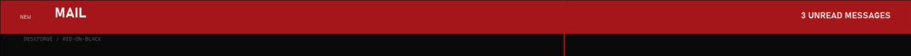

# Alert

A band in the accent colour across the top of the screen, holding a title and a line of text for about 3 s, then it removes itself. Click-through.

Off by default.

## Settings (desk.json)

| Field | Effect |
|---|---|
| `addons.alert` | `true` installs it |

## Data and privacy

None.

## CPU cost

Zero when idle: it only exists for the 3 s it plays.

## Helper

dock.exe, which raises it when a pinned app's unread count goes up while that app is not in front, or on `dock.exe alert "TITLE" "BODY"`.

The preview is a render with made-up data, not a capture of a live desk.