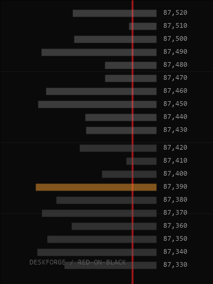

# Depth

The BTCUSDT order book in 10-dollar bins, 10 asks over 10 bids, as bars. The biggest resting order, the wall, gets the warn colour.

Off by default.

## Settings (desk.json)

| Field | Effect |
|---|---|
| `addons.depth` | `true` installs it |

## Data and privacy

api.binance.com, falling back to data-api.binance.vision. Public and keyless. 6 s timeout per request.

## CPU cost

Order book every 4 s. Shares the market helper with Tape; see Tape for the measured cost.

## Helper

market.exe, shared with Tape.

The preview is a render with made-up data, not a capture of a live desk.