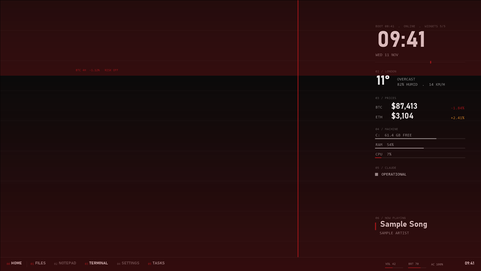

# Mood

A full-screen tint behind the widgets from Bitcoin's rolling 4-hour change: an accent wash from the bottom when it falls, a cold blue when it rises, nothing when flat (under 0.4 percent). Strength tops out at 2 percent.

Off by default.

## Settings (desk.json)

| Field | Effect |
|---|---|
| `addons.mood` | `true` installs it |

## Data and privacy

data-api.binance.vision 4-hour ticker, once a minute. Public and keyless. Rainmeter's WebParser has no timeout; a failed request keeps the last tint.

## CPU cost

One request a minute and one image tint. Close to zero.

## Helper

none (uses `mood.png`, a plain gradient).

The preview is a render with made-up data, not a capture of a live desk.