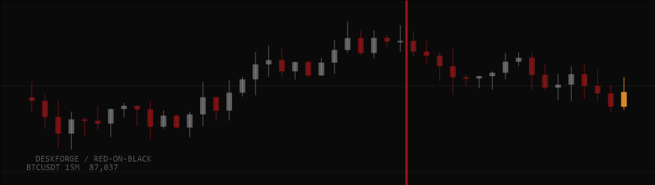

# Tape

BTCUSDT 15-minute candles, 46 of them, drawn in an 850 x 200 box over the wallpaper, with the last price as a line.

Off by default.

## Settings (desk.json)

| Field | Effect |
|---|---|
| `addons.tape` | `true` installs it |

## Data and privacy

api.binance.com, falling back to data-api.binance.vision. Public and keyless. 6 s timeout per request; on failure the last chart stays.

## CPU cost

The market helper fetches every 10 s and pushes plain numbers (heights, positions, colours) to fixed Image meters, so Rainmeter only redraws. No Shape meter is rewritten. Heavier than the core skins: the earlier desk measured Tape and Depth together at about 3.5 percent of one core.

## Helper

market.exe (built from helpers/market.cs), shared with Depth.

The preview is a render with made-up data, not a capture of a live desk.