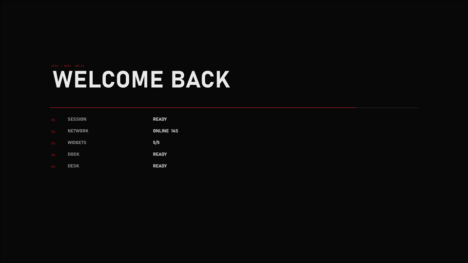

# Boot

The boot and wake reveal. A cover with your line of text, five status lines appearing one by one, then the cover
wipes away and the panel intro replays. About 3 seconds, then the skin removes itself.

## When it plays

- After sign-in, when `startup` is true (the startup check fills in the real network and widget results).
- After unlocking or waking the PC, when the dock helper is running.
Only when `wakeReveal.enabled` is true.

## Settings (desk.json)

| Field | Effect |
|---|---|
| `wakeReveal.enabled` | turns it on or off |
| `wakeReveal.text` | the big line, up to 40 characters (placeholder `WELCOME BACK`) |
| `skins.boot` | `false` leaves it out |

## Safety

Click-through while it plays. Image and String meters only. The last step always deactivates the skin, so it
cannot stay on screen. Turn it off at once with the Rainmeter bang `!DeactivateConfig "deskforge\Boot"`.

## CPU cost

Runs for about 3 s and then unloads. Zero when idle.