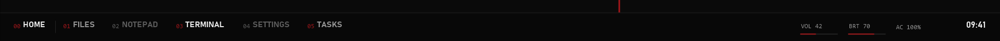

# Dock

A text dock that replaces the taskbar: `00 HOME`, then your pinned apps from `homeApps` (up to 10), then any
other open apps, then volume, brightness, battery and the clock. No icons.

## Look

56 px tall, full width, at the top or bottom. Index numbers in the mono font, labels in the display font.
Idle apps are dim, open apps get an accent index, the focused app is in full ink. A pinned app whose window
title starts with an unread count, like `(3) Inbox`, shows the count. Colours and fonts from the theme.

## Use

| Action | Result |
|---|---|
| click a slot | focus the app, minimize it if it is already in front, or launch it |
| click `00 HOME` or press Win+Z | open Home (Ctrl+Alt+Z if Win+Z is taken) |
| scroll over VOL / BRT | volume or built-in screen brightness up and down |
| click VOL | mute |

## Settings (desk.json)

| Field | Effect |
|---|---|
| `dock` | `top` or `bottom` |
| `homeApps` | the pinned apps, in order |
| `clock` | 12 or 24 hour clock |
| `skins.dock` | `false` leaves it out |

## How it works

`dock.exe` (built from `helpers/dock.cs`) polls open windows every 0.7 s and pushes labels to the skin with
Rainmeter bangs. It registers the strip as an AppBar so maximized windows stop at the dock; the Windows
taskbar is left as it is (set it to auto-hide yourself if you want it out of the way). It hides the dock
under true full-screen apps. It uses only RegisterHotKey, never a keyboard hook, and makes no network calls.

## CPU cost

One window enumeration every 0.7 s and a volume and brightness read every 2.5 s. Expected around 1 percent of
one core; not measured yet.