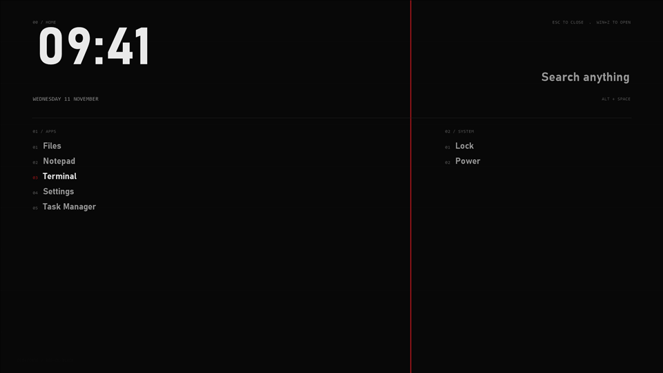

# Home

A full-screen launcher: a very large clock, the date, a search shortcut, your apps from `homeApps` as numbered
rows, and Lock and Power.

## Use

Open with Win+Z or `00 HOME` on the dock. Close with Esc, a click on empty space, or by launching something.
A row focuses the app if it is already open, otherwise launches it. Search opens Windows search (Win+S).
Power opens the normal Windows shut-down dialog; nothing happens until you pick an option there.

## Settings (desk.json)

| Field | Effect |
|---|---|
| `homeApps` | up to 12 rows of `name` and `path` (an .exe, a folder, or a `shell:` / `ms-settings:` link) |
| `clock` | 12 or 24 hour clock |
| `skins.home` | `false` leaves it out |

Rows are written to `@Resources\home.inc` by `tools\install.ps1`. Positions scale with the screen size.

## CPU cost

Hidden almost all the time and updates every 5 s. Close to zero.