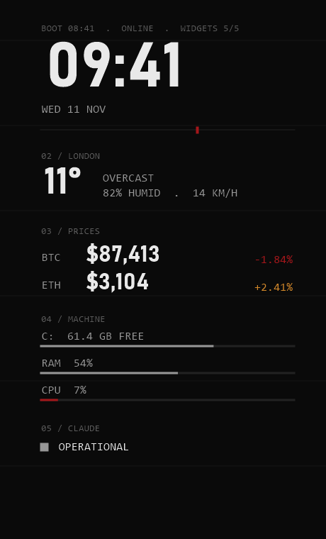

# Panel

The core widget: a large clock with a seconds track, the weather for your city, disk, memory and CPU load,
and the Claude status page. Optionally, one or two coin prices with their 24-hour change (off by default).

## Look

Five numbered sections in a 360 px column, labelled `01` to `05`. On load each section rises 24 px and fades
in, 0.15 s apart, in about 1.3 s. If the intro ever fails the panel is simply shown in full. Colours and fonts
come from the theme. The preview above is a render from `tools/render-previews.ps1` with the sample data in
`examples/`, not a capture of a live desk.

## Settings (desk.json)

| Field | Effect |
|---|---|
| `city` | label for section 02 (text only) |
| `latitude`, `longitude` | where the weather comes from |
| `units` | `c` for Celsius and km/h, `f` for Fahrenheit and mph |
| `clock` | `12` or `24` |
| `coins` | optional: empty (the default) hides section 03 and sends no price request; or one or two CoinGecko ids, for example `bitcoin`, `ethereum` |
| `refreshSeconds` | how often prices refresh, 60 or more |
| `skins.panel` | `false` leaves the panel out |

## Data and privacy

Keyless public sources: Open-Meteo (weather), status.claude.com (status) and, only when `coins` is not empty,
CoinGecko (prices).
The only thing sent is the request itself: your latitude and longitude go to Open-Meteo. Nothing else
leaves the machine. When a request fails the section label shows `OFFLINE` or `NO DATA` and the panel keeps
retrying on its normal schedule. Rainmeter's WebParser has no timeout setting of its own, so a hung request
simply waits for the next update.

## CPU cost

Redraws once a second. Weather every 10 minutes, prices every `refreshSeconds`, status every 5 minutes.
Expected well under 1 percent of one core. The measured number belongs to the Stage 4 pass rules and is not
recorded yet.

## Files

`Panel.ini` (the skin). It reads `@Resources\theme.inc` and `@Resources\desk.inc`, both written by
`tools\install.ps1`. The optional boot line at the top reads `@Resources\bootcheck.txt`, written by the
startup check.
