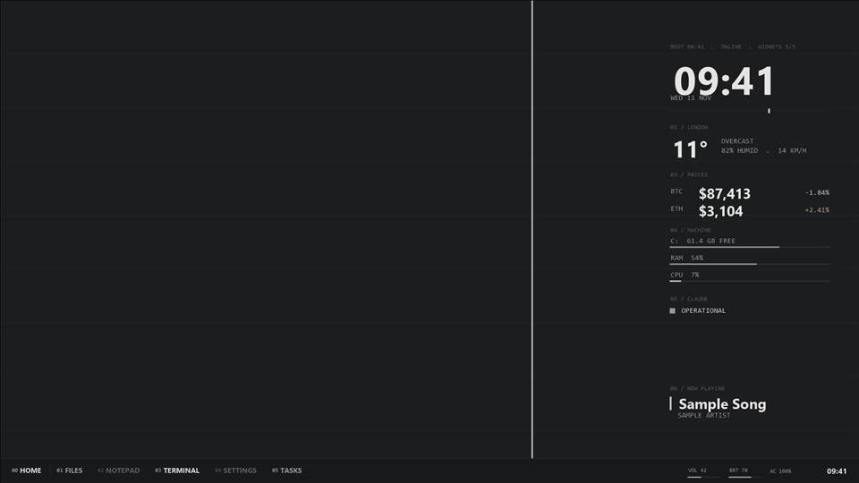

# Minimal grey

Soft graphite with no colour accent at all. The accent is a light grey, so the stake and ticks read as light, not colour.

## Use it

Set `"theme": "minimal-grey"` in `config\desk.json`, then run `tools\install.ps1` (dry run) and `tools\install.ps1 -Apply`.
To switch themes later: `tools\restore.ps1 -Phase theme`, change the field, and install again.

## Settings

| Key | Value |
|---|---|
| `bg` | `#1c1d1f` |
| `surface` | `#18191b` |
| `ink` | `#e4e4e2` |
| `mid` | `#9a9b9d` |
| `dim` | `#5f6063` |
| `rule` | `#2c2d30` |
| `accent` | `#d0d0cc` |
| `warn` | `#b8a27a` |
| `onAccent` | `#1c1d1f` |

Fonts: Segoe UI (display), Consolas (mono). All ship with Windows 10.

Wallpaper: `wallpaper.png`, 1920 x 1080, drawn by `tools\render-previews.ps1`: the background colour, faint
horizontal rules every 120 px, and one accent line at the golden ratio. Windows scales it to fit other screens.

Good for: The quietest desk. Good with colourful app windows on top.

## CPU cost

None of its own. A theme only sets colours, fonts and the wallpaper.

The preview is a render with the sample data in `examples/`, not a capture of a live desk.