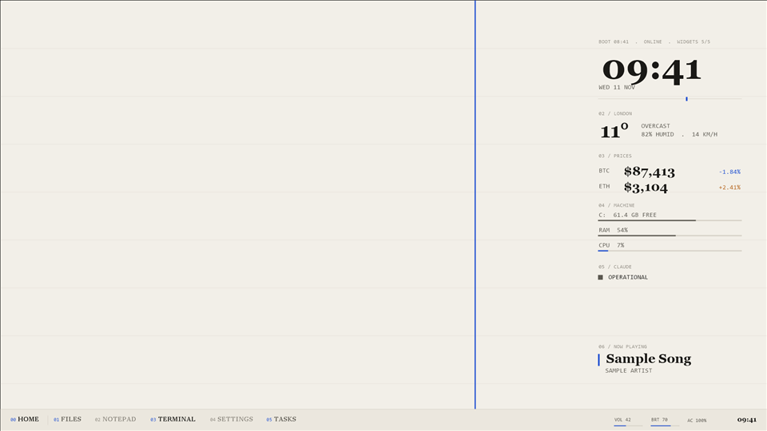

# Paper light

A warm paper background with dark ink and a blue accent. Rising prices and warnings use a burnt orange.

## Use it

Set `"theme": "paper-light"` in `config\desk.json`, then run `tools\install.ps1` (dry run) and `tools\install.ps1 -Apply`.
To switch themes later: `tools\restore.ps1 -Phase theme`, change the field, and install again.

## Settings

| Key | Value |
|---|---|
| `bg` | `#f2efe8` |
| `surface` | `#ebe7de` |
| `ink` | `#1b1a17` |
| `mid` | `#5b5850` |
| `dim` | `#8c887f` |
| `rule` | `#d6d1c6` |
| `accent` | `#1f4fd1` |
| `warn` | `#b5651d` |
| `onAccent` | `#ffffff` |

Fonts: Georgia (display), Consolas (mono). All ship with Windows 10.

Wallpaper: `wallpaper.png`, 1920 x 1080, drawn by `tools\render-previews.ps1`: the background colour, faint
horizontal rules every 120 px, and one accent line at the golden ratio. Windows scales it to fit other screens.

Good for: Bright rooms and daytime work. Text on paper reads like print.

## CPU cost

None of its own. A theme only sets colours, fonts and the wallpaper.

The preview is a render with the sample data in `examples/`, not a capture of a live desk.