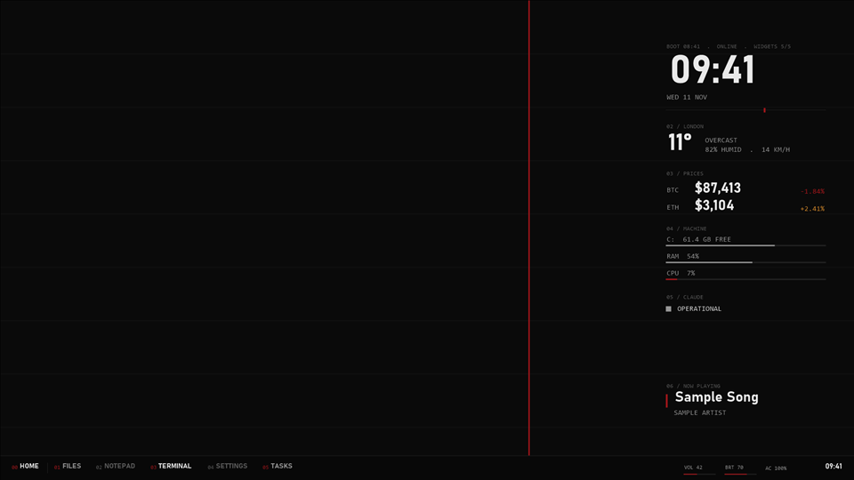

# Red on black

The default. A near-black desk, off-white type, one deep red accent for the stake, the seconds tick and falling prices, and an amber for rising prices and warnings.

## Use it

Set `"theme": "red-on-black"` in `config\desk.json`, then run `tools\install.ps1` (dry run) and `tools\install.ps1 -Apply`.
To switch themes later: `tools\restore.ps1 -Phase theme`, change the field, and install again.

## Settings

| Key | Value |
|---|---|
| `bg` | `#0a0a0a` |
| `surface` | `#080808` |
| `ink` | `#e9e9e9` |
| `mid` | `#969696` |
| `dim` | `#5c5c5c` |
| `rule` | `#222222` |
| `accent` | `#a4161a` |
| `warn` | `#d4892a` |
| `onAccent` | `#ffffff` |

Fonts: Bahnschrift (display), Consolas (mono). All ship with Windows 10.

Wallpaper: `wallpaper.png`, 1920 x 1080, drawn by `tools\render-previews.ps1`: the background colour, faint
horizontal rules every 120 px, and one accent line at the golden ratio. Windows scales it to fit other screens.

Good for: Any room, any time. The highest contrast of the four.

## CPU cost

None of its own. A theme only sets colours, fonts and the wallpaper.

The preview is a render with the sample data in `examples/`, not a capture of a live desk.