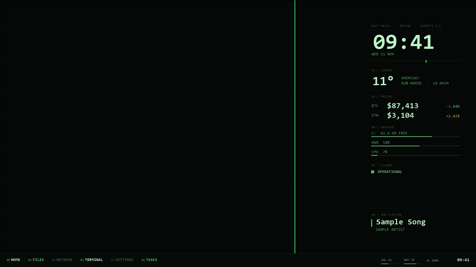

# Terminal green

Phosphor green on a black-green screen. Every font is monospace, the accent is a brighter green, warnings are amber.

## Use it

Set `"theme": "terminal-green"` in `config\desk.json`, then run `tools\install.ps1` (dry run) and `tools\install.ps1 -Apply`.
To switch themes later: `tools\restore.ps1 -Phase theme`, change the field, and install again.

## Settings

| Key | Value |
|---|---|
| `bg` | `#050806` |
| `surface` | `#070b08` |
| `ink` | `#b8f5c4` |
| `mid` | `#5fae72` |
| `dim` | `#2f5a3a` |
| `rule` | `#12261a` |
| `accent` | `#3fd46b` |
| `warn` | `#e0b341` |
| `onAccent` | `#050806` |

Fonts: Consolas (display and mono). All ship with Windows 10.

Wallpaper: `wallpaper.png`, 1920 x 1080, drawn by `tools\render-previews.ps1`: the background colour, faint
horizontal rules every 120 px, and one accent line at the golden ratio. Windows scales it to fit other screens.

Good for: Night work and anyone who misses a CRT.

## CPU cost

None of its own. A theme only sets colours, fonts and the wallpaper.

The preview is a render with the sample data in `examples/`, not a capture of a live desk.